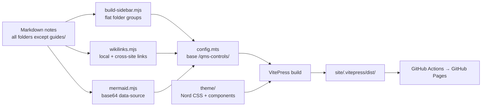

# Development guide — QMS_controls

This repository publishes every vault folder **except `guides/`**. Its counterpart `qms-demo` publishes the guides. The two sites are independent: separate repos, configs, workflows and deployments.

## Architecture at a glance



## Repository map

| Path | Purpose |
|---|---|
| `vault/` | The folder opened in Tolaria; all published notes live here |
| `vault/policies/`, `vault/procedures/`, `vault/instructions/` | Controlled QMS documents |
| `records/`, `audits/`, `capa/`, `registers/` | Evidence, findings, actions and indexes |
| `iso-9001/` | 2026 clauses and cited 2015 clauses |
| `templates/`, `dashboards/`, `people/`, `roles/`, `inbox/`, `types/`, `views/` | Reference and workflow material |
| `index.md`, `README.md`, `AGENTS.md`, `lessons-learned.md` | Published top-level docs |
| `site/.vitepress/config.mts` | Title `QMS_controls`, base `/qms-controls/`, nav |
| `site/.vitepress/publish-scope.mjs` | Published folders + `REMOTE_BASE` |
| `site/.vitepress/wikilinks.mjs` | Local links, cross-site absolute links, "not published" |
| `site/.vitepress/mermaid.mjs` | Mermaid fence → renderable container |
| `site/.vitepress/build-sidebar.mjs` | Flat folder-group sidebar |
| `site/.vitepress/remote-manifest.json` | Guide stems from QMS_demo |
| `site/.vitepress/prepare-modules.mjs` | Creates `vault/node_modules` → `site/node_modules` symlink |
| `site/.vitepress/theme/` | Nord CSS, Mermaid overlay, sidebar controls, resume card |
| `scripts/validate-vault.py`, `scripts/validate-wikilinks.py` | Local checks |
| `.github/workflows/deploy.yml` | Build and deploy |

## Data model (short version)

Type comes from `type:` frontmatter, not folder. `doc_id` is permanent identity; `revision` is the edition. Only `type`, `status`, `tags` drive saved views. Use `related_to` for relationships, `implements` for the policy link. Wikilinks resolve by filename stem or H1. Full rules: `AGENTS.md`.

## Build pipeline

1. `npm run docs:prepare` creates the symlink and regenerates `sidebar.json`.
2. `config.mts` derives `srcExclude` from `publish-scope.mjs`; `guides/` and non-published root files are skipped.
3. Markdown plugins rewrite wikilinks and mermaid fences.
4. VitePress writes `site/.vitepress/dist/`.
5. GitHub Actions publishes that folder to GitHub Pages.

## Theme slots

| Slot | Component | Job |
|---|---|---|
| `layout-top` | `MermaidMount.vue` | Diagrams, theme changes, navigation, reading position |
| `doc-before` | `ContinueReading.vue` | Homepage resume card |
| `sidebar-nav-before` | `SidebarControls.vue` | Expand all / collapse all |
| `nav-bar-content-before` | `SidebarToggle.vue` | Hide / show navigation |

Guide-only components (`ChapterBanner.vue`, `ChapterNav.vue`) were deliberately not copied — there is no numeric chapter hierarchy here.

## Commands

```sh
# from the repo root
python3 scripts/validate-vault.py
python3 scripts/validate-wikilinks.py

# from site/
npm ci
npm run docs:dev
npm run docs:build
```

## Deployment

- Remote: `git@github.com:jetra360/qms-controls.git`.
- Push to `main` triggers *Build & Deploy QMS Site*.
- GitHub → Settings → Pages → Source: **GitHub Actions**.
- Live: `https://jetra360.github.io/qms-controls/`.
- The site is static and remains online when this machine is off.

## Verification checklist

- [ ] Both validators pass (the four frontmatter notices are intentional).
- [ ] `npm run docs:build` succeeds.
- [ ] Sidebar groups are flat and cover the published folders.
- [ ] A wikilink to a guide opens `qms-demo` with "↗" and `target="_blank"`.
- [ ] Sidebar toggle, theme switch, diagram overlays and resume card work.
- [ ] Workflow is green and the live URL returns 200.

## Common changes

| Task | Where |
|---|---|
| Publish another folder | `publish-scope.mjs` → `PUBLISHED_FOLDERS` |
| Change site name / URL | `config.mts` (`title`, `base`) and the repo name |
| Rename or add a note | Refresh `remote-manifest.json` in **both** repos |
| Change colours | `theme/custom.css` variables |
| Add a nav item | `config.mts` → `themeConfig.nav` |

## Pitfalls — do not reintroduce

- Never alias `vue`; it breaks hydration.
- Never hand-edit `sidebar.json`.
- Mermaid source belongs in `data-source`, not raw newlines in HTML.
- VitePress scopes `.VPSidebar`; padding overrides need `!important`.
- `nav-bar-title-after` is inside the title anchor; use `nav-bar-content-before`.
- SSR has no `btoa` or `localStorage`.
- Keep the two repos independent; never import code from the other one.
